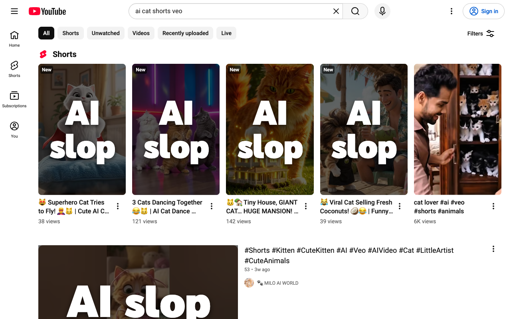

# SlopStopper

A browser extension that covers the thumbnails of AI-labeled YouTube videos
with a big **"AI slop"** overlay, so you can spot them before you click.

YouTube labels videos made with AI, but it only shows the label (an **AI**
badge under the title, and a "How this was made → Made with AI" section in the
description) after you open the video. SlopStopper looks those labels up for
every thumbnail on the page and marks the ones that have them.

It works on any `www.youtube.com` page that lists videos, including Home,
Subscriptions, search results, the watch-page sidebar, and channel pages, as
well as the player's end-of-video suggestions. It handles both regular videos
and Shorts.

## Install (unpacked)

**Chrome, Edge, Brave, Arc, and other Chromium browsers**

1. Open `chrome://extensions` (or `edge://extensions`, `brave://extensions`, …).
2. Turn on **Developer mode**.
3. Click **Load unpacked** and select this folder (the one containing
   `manifest.json`).
4. Reload any open YouTube tabs.

**Firefox (121+)**

1. Open `about:debugging#/runtime/this-firefox`.
2. Click **Load Temporary Add-on…** and pick `manifest.json`.

## Publishing

`scripts/package.sh` builds the Chrome Web Store zip into `dist/`. The same zip
works for Edge Add-ons. [`store/LISTING.md`](store/LISTING.md) has the listing
text, the privacy-tab answers, and the list of images to upload.

## How it works

`src/content.js` runs on YouTube pages and does the following:

1. Finds every video thumbnail (`yt-thumbnail-view-model` / `ytd-thumbnail`,
   plus the player's end-screen grid, "Up next" card, and creator end cards)
   and reads the video ID from its link (`/watch?v=…` or `/shorts/…`).
   Playlist and mix thumbnails are skipped.
2. When a thumbnail comes within about one screen of the viewport, it asks
   YouTube's watch-page API (`POST /youtubei/v1/next`) for that video. An
   `X-Goog-FieldMask` header limits the response to the two fields that carry
   the label, which brings it from about 400 KB down to under 1 KB.
3. It treats a video as AI if either of these is present:
   - a title badge `metadataBadgeRenderer` with label `AI` ("Content was made
     with AI"), or
   - a `howThisWasMadeSectionViewModel` that reads "Made with AI" / "altered or
     fully generated". The same section is also used for "Auto-dubbed", which
     is ignored.
4. Verdicts are cached in `chrome.storage.local`: 30 days for AI videos,
   3 days for others (labels are sometimes added after upload).

It runs at most 4 requests at a time and backs off for 30 s if YouTube returns
HTTP 429.

## Privacy

- Lookups go only to `www.youtube.com`, the site you're already on.
- Requests are sent **without cookies** (`credentials: 'omit'`), so they're
  anonymous. They don't touch your account or watch history.
- Nothing is collected or sent anywhere else.

See [PRIVACY.md](PRIVACY.md) for the full policy.

## Limitations

- It only knows what YouTube knows. Videos whose creators didn't disclose AI
  use, and that YouTube didn't label itself, aren't flagged.
- `m.youtube.com` and YouTube Music aren't supported.
- The overlay is drawn on the thumbnail, so YouTube's hover preview player
  plays on top of it.
- This relies on YouTube's internal API and markup, which change without
  notice. If overlays stop appearing, those changes are the most likely cause.

## Development

- Set `DEBUG = true` at the top of `src/content.js` to log lookups to the
  console with the `[SlopStopper]` prefix.
- After editing, click the reload icon for the extension on
  `chrome://extensions`, then reload the YouTube tab.
- Icons are generated by `scripts/make_icons.py` (needs Pillow).
